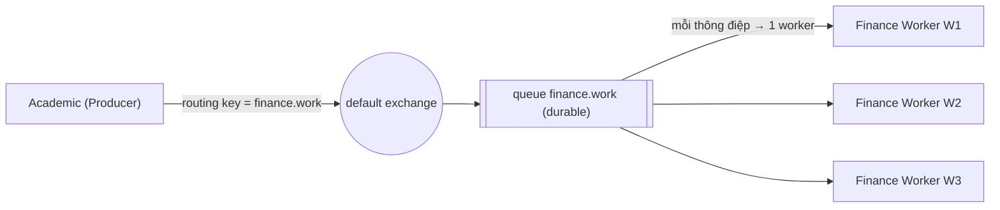
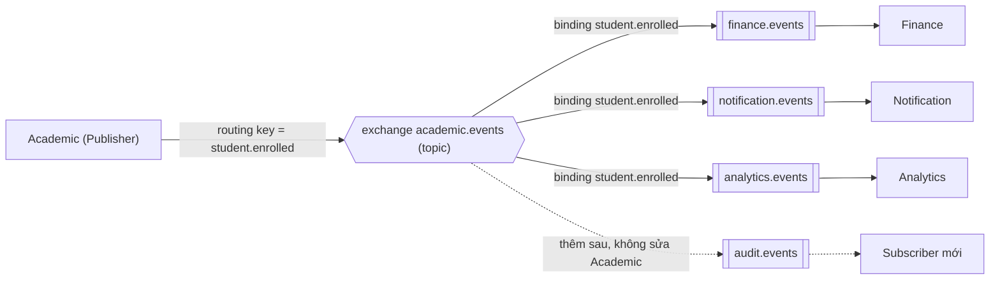
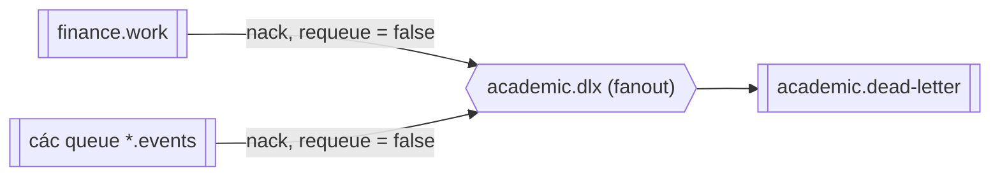
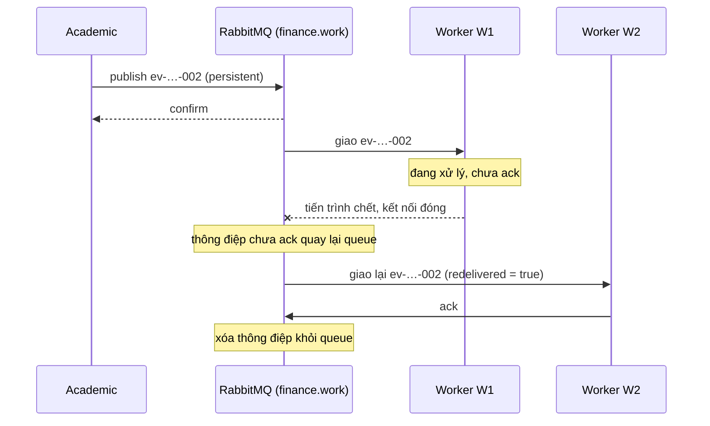
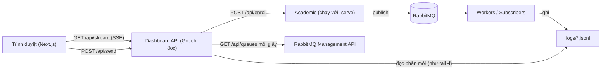
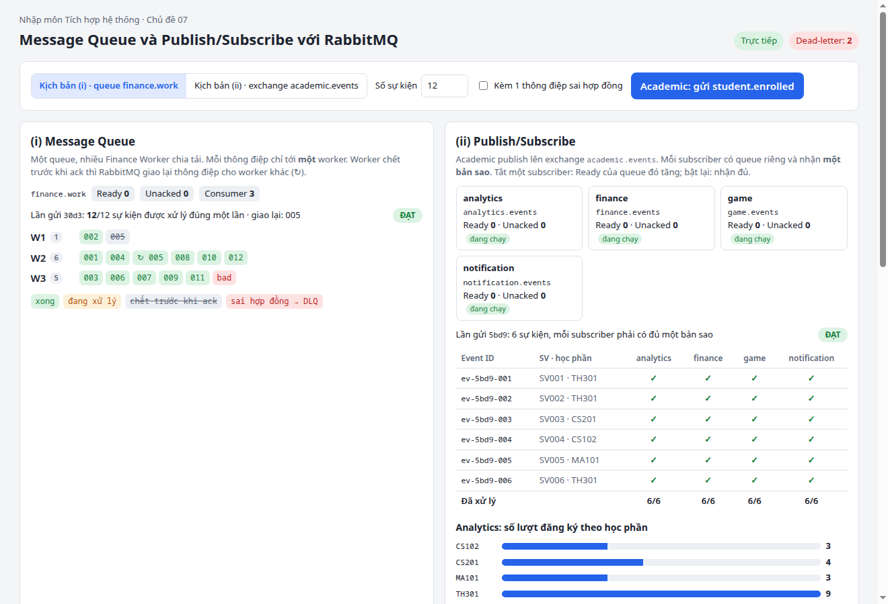
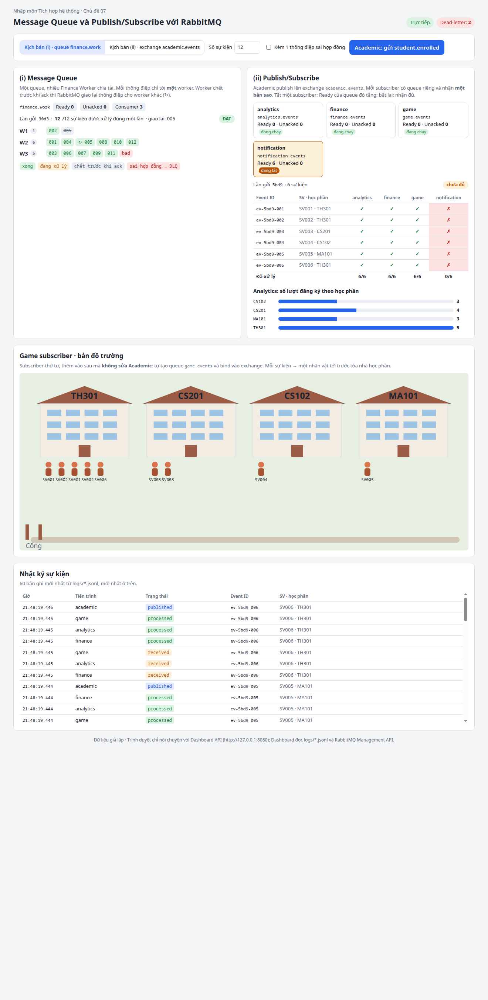

# BÁO CÁO BÀI TẬP LỚN

**Học phần:** Nhập môn Tích hợp hệ thống
**Giảng viên:** TS. Nguyễn Huy Trung
**Chủ đề 07:** Tích hợp theo mô hình Message Queue và Publish/Subscribe

| Thành viên | Mã sinh viên | Vai trò chính |
|---|---|---|
| [Họ tên thành viên 1] | [MSSV] | Hạ tầng RabbitMQ, thư viện dùng chung, Academic, Finance Worker, công cụ đối chiếu |
| [Họ tên thành viên 2] | [MSSV] | Các subscriber kịch bản (ii), trang web demo, phần lý thuyết |
| [Họ tên thành viên 3] | [MSSV] | Kịch bản kiểm thử T1–T9, minh chứng, hướng dẫn cài đặt và chạy lại |

Mã nguồn: <https://github.com/DANG-PH/thht-27>

---

## Mục lục

1. [Mô tả bài toán](#1-mô-tả-bài-toán)
2. [Kiến thức vận dụng](#2-kiến-thức-vận-dụng)
3. [Phân tích và thiết kế](#3-phân-tích-và-thiết-kế)
4. [Cài đặt và chạy lại demo](#4-cài-đặt-và-chạy-lại-demo)
5. [Kiểm thử và minh chứng](#5-kiểm-thử-và-minh-chứng)
6. [Nhận xét và thảo luận](#6-nhận-xét-và-thảo-luận)
7. [Hạn chế và hướng phát triển](#7-hạn-chế-và-hướng-phát-triển)
8. [Công cụ hỗ trợ đã sử dụng](#8-công-cụ-hỗ-trợ-đã-sử-dụng)
9. [Tài liệu tham khảo](#9-tài-liệu-tham-khảo)

---

## 1. Mô tả bài toán

### 1.1. Bối cảnh

Khi một sinh viên đăng ký học phần trên hệ thống **Academic**, nhiều hệ thống khác cần biết sự kiện này:

- **Finance** lập khoản học phí tương ứng với số tín chỉ;
- **Notification** gửi thông báo xác nhận cho sinh viên;
- **Analytics** cập nhật thống kê số lượt đăng ký theo học phần.

Nếu Academic gọi trực tiếp từng hệ thống (ví dụ gọi REST API lần lượt), Academic sẽ:

- **phụ thuộc vào thời điểm hoạt động** của mọi hệ thống: một hệ thống chậm hoặc ngừng thì thao tác đăng ký bị chậm hoặc lỗi theo;
- **phụ thuộc vào danh sách bên nhận**: mỗi lần thêm một hệ thống cần biết sự kiện, phải sửa và triển khai lại Academic;
- **không chia tải được**: khi số lượt đăng ký tăng đột biến đầu học kỳ, Finance phải xử lý kịp ngay lúc nhận.

### 1.2. Mục tiêu

Dùng **message broker** (RabbitMQ) làm trung gian để Academic chỉ cần phát sự kiện `student.enrolled` một lần. Theo yêu cầu đề, xây dựng **hai kịch bản độc lập**:

| Kịch bản | Mô hình | Bài toán giải quyết |
|---|---|---|
| (i) | **Message Queue** – một queue, nhiều Finance Worker | Chia tải xử lý học phí cho nhiều tiến trình; mỗi sự kiện chỉ được xử lý một lần |
| (ii) | **Publish/Subscribe** – mỗi ứng dụng một queue riêng | Một sự kiện tới được nhiều ứng dụng; thêm ứng dụng mới không phải sửa Academic |

### 1.3. Phạm vi

- Mô hình thử nghiệm nhỏ, chạy được trên một máy, có thể chạy lại.
- Dữ liệu là **dữ liệu giả lập** (12 lượt đăng ký trong `data/enrollments.csv`), không dùng dữ liệu cá nhân thật.
- Nghiệp vụ trong từng ứng dụng được giản lược (in ra kết quả xử lý); trọng tâm là cơ chế trao đổi thông điệp.

---

## 2. Kiến thức vận dụng

### 2.1. Tích hợp hướng sự kiện (Event-driven Integration)

Một **sự kiện** là thông báo rằng một việc *đã xảy ra* (ví dụ "sinh viên SV001 đã đăng ký TH301"). Bên phát sự kiện không ra lệnh cho bên nhận phải làm gì; mỗi bên nhận tự quyết định phản ứng. Nhờ vậy bên phát và bên nhận **lỏng lẻo về phụ thuộc** (loose coupling): chúng chỉ cần thống nhất về định dạng sự kiện, không cần biết nhau.

### 2.2. Các khái niệm cơ bản

| Khái niệm | Ý nghĩa | Trong demo |
|---|---|---|
| **Message** | Gói dữ liệu truyền giữa các ứng dụng, gồm phần thân (body) và thuộc tính (header/properties) | JSON `student.enrolled` + thuộc tính `message_id`, `type`, `delivery_mode` |
| **Message Channel** | Kênh logic mà thông điệp đi qua; bên gửi và bên nhận chỉ biết kênh, không biết nhau | Queue `finance.work`, exchange `academic.events`, các queue `*.events` |
| **Producer / Publisher** | Ứng dụng tạo và gửi thông điệp | Academic |
| **Consumer / Subscriber** | Ứng dụng nhận và xử lý thông điệp | Finance Worker, Finance, Notification, Analytics |
| **Message Broker** | Phần mềm trung gian nhận, lưu, định tuyến và giao thông điệp | RabbitMQ 4.1 |

### 2.3. Message Queue (Point-to-Point Channel)

Trong mô hình hàng đợi, thông điệp được đưa vào **một queue**. Nhiều consumer có thể cùng đọc queue đó, nhưng **mỗi thông điệp chỉ được giao cho một consumer**. Các consumer "cạnh tranh" nhau lấy việc nên mẫu này còn gọi là **Competing Consumers**. Lợi ích: tăng số consumer để tăng thông lượng, không cần sửa producer.

> Lưu ý thuật ngữ: *Point-to-Point Channel* ở đây là một loại **kênh** (mỗi thông điệp tới một bên nhận), khác với *kiến trúc Point-to-Point* (các ứng dụng nối trực tiếp với nhau) trong chủ đề so sánh với Hub-and-Spoke.

### 2.4. Publish/Subscribe

Trong mô hình Pub/Sub, publisher gửi sự kiện lên một kênh chung; **mỗi subscriber đã đăng ký nhận một bản sao** của sự kiện. Các subscriber không ảnh hưởng nhau: một subscriber chậm hay ngừng không làm subscriber khác mất sự kiện.

### 2.5. So sánh Message Queue và Publish/Subscribe

| Tiêu chí | Message Queue | Publish/Subscribe |
|---|---|---|
| Một thông điệp được giao cho | Đúng một consumer trong nhóm | Mọi subscriber đã đăng ký (mỗi bên một bản sao) |
| Mục đích chính | Chia tải, xử lý song song cùng một loại việc | Phân phối sự kiện tới nhiều ứng dụng khác nhau |
| Thêm consumer | Tăng thông lượng, tổng số lần xử lý không đổi | Thêm một ứng dụng nhận sự kiện, tổng số bản sao tăng |
| Quan hệ giữa các consumer | Cùng một ứng dụng, nhiều tiến trình | Khác ứng dụng, khác nghiệp vụ |
| Trong RabbitMQ | Nhiều consumer đọc **chung một queue** | Mỗi subscriber **một queue riêng** bind vào exchange |

Hai mô hình có thể kết hợp: ở kịch bản (ii), nếu Finance cần chia tải, có thể chạy nhiều tiến trình Finance cùng đọc queue `finance.events`; khi đó giữa các ứng dụng là Pub/Sub, bên trong Finance là Message Queue.

### 2.6. Mô hình định tuyến của RabbitMQ (AMQP 0-9-1)

Producer trong RabbitMQ không gửi thẳng vào queue mà gửi tới **exchange** kèm một **routing key**. Exchange dựa vào các **binding** (liên kết exchange → queue, kèm binding key) để quyết định thông điệp được chép vào queue nào.

| Loại exchange | Quy tắc định tuyến | Dùng trong demo |
|---|---|---|
| Default exchange (tên rỗng `""`) | Loại direct có sẵn; mọi queue tự động được bind với key = tên queue | Kịch bản (i): routing key `finance.work` |
| Direct | Routing key phải trùng binding key | – |
| Fanout | Chép tới mọi queue đã bind, bỏ qua routing key | Dead-letter exchange `academic.dlx` |
| Topic | So khớp theo mẫu, các từ phân cách bằng dấu chấm; `*` khớp đúng một từ, `#` khớp không hoặc nhiều từ | Kịch bản (ii): `academic.events` |

Nếu không có binding nào khớp, thông điệp bị bỏ đi (trừ khi dùng cờ `mandatory` hoặc alternate exchange). Đây là lý do subscriber được thêm sau không nhận được các sự kiện đã phát trước đó (mục 6.4).

### 2.7. Cơ chế bảo đảm tin cậy

| Cơ chế | Mô tả | Giải quyết vấn đề |
|---|---|---|
| **Durable queue/exchange** | Định nghĩa queue/exchange được lưu, còn sau khi broker khởi động lại | Mất cấu hình khi broker restart |
| **Persistent message** (`delivery_mode = 2`) | Thông điệp được ghi xuống đĩa | Mất thông điệp đang chờ khi broker restart |
| **Publisher confirm** | Broker xác nhận với producer khi đã nhận (và lưu) thông điệp | Producer tưởng đã gửi nhưng thông điệp mất trên đường |
| **Consumer acknowledgement** (ack thủ công) | Consumer chỉ báo ack sau khi xử lý xong; thông điệp chưa ack ở trạng thái *Unacked* | Consumer chết giữa chừng làm mất thông điệp |
| **Redelivery** | Kết nối của consumer đóng khi còn thông điệp chưa ack → broker đưa lại vào queue, giao cho consumer khác với cờ `redelivered = true` | Như trên |
| **Prefetch (QoS)** | Giới hạn số thông điệp chưa ack mà broker giao cho một consumer | Worker chậm bị dồn việc trong khi worker khác rảnh |
| **Dead-letter exchange/queue** | Thông điệp bị từ chối (`nack`, `requeue = false`) được chuyển sang exchange dự phòng | Thông điệp lỗi bị mất hoặc bị giao lại vô hạn |

Với ack thủ công, RabbitMQ bảo đảm mỗi thông điệp được giao **ít nhất một lần** (*at-least-once*), không bảo đảm **đúng một lần**. Khi cần tránh xử lý trùng, consumer phải **idempotent**: ghi nhận các `event_id` đã xử lý và bỏ qua nếu gặp lại.

### 2.8. So sánh một số công cụ truyền thông điệp

| Công cụ | Mô hình | Lưu thông điệp | Xác nhận xử lý | Subscriber tham gia muộn |
|---|---|---|---|---|
| **RabbitMQ** | Broker có queue; định tuyến linh hoạt qua exchange | Có (durable + persistent) | Có (ack/nack) | Chỉ nhận sự kiện phát sau khi có queue của mình |
| **Redis Pub/Sub** | Gửi trực tiếp tới các client đang kết nối | Không | Không | Mất mọi thông điệp phát khi không kết nối |
| **NATS (core)** | Pub/Sub theo subject; *queue group* để chia tải | Không (cần JetStream để lưu) | Không (JetStream có ack) | Như Redis Pub/Sub |
| **Apache Kafka** | Log phân tán, chia partition; consumer tự giữ vị trí đọc (offset) | Có, theo thời hạn lưu | Commit offset | Có thể đọc lại từ đầu log (replay) |

**Lý do chọn RabbitMQ:** đề gợi ý RabbitMQ; một broker hỗ trợ cả hai mô hình chỉ bằng cách khai báo topology khác nhau; có sẵn ack, persistence, dead-letter; trang quản trị cho phép quan sát số thông điệp *Ready*/*Unacked* để làm minh chứng. Kafka mạnh khi cần lưu và phát lại luồng sự kiện lớn, nhưng vượt quá phạm vi một demo nhỏ.

---

## 3. Phân tích và thiết kế

### 3.1. Thành phần hệ thống

| Thành phần | Vai trò | Mã nguồn | Trạng thái |
|---|---|---|---|
| RabbitMQ 4.1 + trang quản trị | Message broker | `docker-compose.yml` | Hoàn thành |
| Academic | Producer: đọc dữ liệu giả lập, phát `student.enrolled` | `cmd/academic` | Hoàn thành |
| Finance Worker (W1, W2, W3) | Consumer kịch bản (i): lập khoản học phí | `cmd/finance-worker` | Hoàn thành |
| Finance | Subscriber kịch bản (ii): ghi nhận nghĩa vụ học phí | `cmd/finance-sub` | Hoàn thành |
| Notification | Subscriber kịch bản (ii): thông báo cho sinh viên (giả lập) | `cmd/notification-sub` | Hoàn thành |
| Analytics | Subscriber kịch bản (ii): thống kê lượt đăng ký và tín chỉ theo học phần | `cmd/analytics-sub` | Hoàn thành |
| Game | Subscriber thứ tư, thêm sau để chứng minh không phải sửa publisher | `cmd/game-sub` | Hoàn thành |
| Thư viện dùng chung | Hợp đồng thông điệp, kết nối/khai báo, vòng lặp nhận có ack, nhật ký | `internal/*` | Hoàn thành |
| Verify | Đối chiếu nhật ký, kết luận đạt/không đạt | `cmd/verify` | Hoàn thành |
| Dashboard API | Dịch vụ chỉ đọc cho trang web: đẩy nhật ký và số liệu queue qua SSE, chuyển tiếp lệnh gửi | `cmd/dashboard` | Hoàn thành |
| Trang web demo | Giao diện trình diễn hai kịch bản theo thời gian thực | `web/` | Hoàn thành |
| Kịch bản kiểm thử | Chạy tự động T1–T9 với RabbitMQ thật, lưu minh chứng | `scripts/e2e.sh` | Hoàn thành |

Ngôn ngữ và công cụ: Go 1.22 với thư viện `github.com/rabbitmq/amqp091-go` (thư viện AMQP chính thức cho Go); RabbitMQ 4.1; trang web Next.js 16 (React 19, TypeScript).

### 3.2. Kiến trúc kịch bản (i) – Message Queue



### 3.3. Kiến trúc kịch bản (ii) – Publish/Subscribe



### 3.4. Xử lý thông điệp lỗi (dead-letter)



### 3.5. Topology RabbitMQ

| Tên | Loại | Thuộc tính | Liên kết | Bên khai báo |
|---|---|---|---|---|
| `finance.work` | Queue | durable, `x-dead-letter-exchange = academic.dlx` | Default exchange, key `finance.work` | Academic và Finance Worker |
| `academic.events` | Exchange topic | durable | – | Academic và mọi subscriber |
| `finance.events`, `notification.events`, `analytics.events` | Queue | durable, `x-dead-letter-exchange = academic.dlx` | `academic.events`, key `student.enrolled` | **Chính subscriber đó** |
| `academic.dlx` | Exchange fanout | durable | – | Mọi bên (qua thư viện chung) |
| `academic.dead-letter` | Queue | durable | `academic.dlx` | Mọi bên (qua thư viện chung) |

Khai báo trong RabbitMQ là *idempotent* (khai báo lại một queue đã có cùng thuộc tính không gây lỗi), nên bên nào khởi động trước cũng được. Mọi khai báo đi qua một nơi duy nhất (`internal/mq`) để tham số luôn giống nhau; nếu khác, RabbitMQ trả lỗi `PRECONDITION_FAILED`.

### 3.6. Hợp đồng thông điệp `student.enrolled`

Ví dụ phần thân:

```json
{
  "event_id": "ev-a3f9-001",
  "event_type": "student.enrolled",
  "occurred_at": "2026-11-26T03:00:00Z",
  "student_id": "SV001",
  "full_name": "Nguyễn Văn An",
  "course_id": "TH301",
  "course_name": "Nhập môn tích hợp hệ thống",
  "credits": 3,
  "semester": "2026-1"
}
```

| Trường | Kiểu | Bắt buộc | Ràng buộc |
|---|---|---|---|
| `event_id` | chuỗi | Có | Duy nhất; dạng `ev-<mã lần gửi>-<số thứ tự>` |
| `event_type` | chuỗi | Có | Bằng `student.enrolled` |
| `occurred_at` | thời điểm (UTC) | Không | – |
| `student_id` | chuỗi | Có | Khác rỗng |
| `full_name` | chuỗi | Không | – |
| `course_id` | chuỗi | Có | Khác rỗng |
| `course_name` | chuỗi | Không | – |
| `credits` | số nguyên | Có | Lớn hơn 0 |
| `semester` | chuỗi | Không | – |

Thuộc tính AMQP đi kèm: `message_id = event_id` (đọc được ID kể cả khi phần thân hỏng), `type = student.enrolled`, `content_type = application/json`, `delivery_mode = 2` (persistent), `app_id = academic`, `timestamp`.

Consumer **bỏ qua các trường lạ** thay vì từ chối (nguyên tắc *tolerant reader*): Academic thêm trường mới thì consumer cũ vẫn chạy.

### 3.7. Luồng dữ liệu

**Kịch bản (i):**

1. Academic đọc một dòng dữ liệu giả lập, tạo sự kiện với `event_id` mới.
2. Academic publish tới default exchange với routing key `finance.work`, chờ **publisher confirm**.
3. RabbitMQ đưa thông điệp vào queue `finance.work` và giao cho một worker còn trống (prefetch = 1).
4. Worker kiểm tra hợp đồng, xử lý (lập khoản học phí), rồi gửi **ack**.
5. RabbitMQ xóa thông điệp khỏi queue. Nếu worker chết trước bước này, thông điệp được giao lại cho worker khác.

**Kịch bản (ii):**

1. Academic publish tới exchange `academic.events` với routing key `student.enrolled`, chờ confirm.
2. Exchange chép thông điệp vào **mọi** queue có binding khớp (`finance.events`, `notification.events`, `analytics.events`).
3. Mỗi subscriber đọc queue riêng của mình, xử lý và ack độc lập với các subscriber khác.

**Diễn biến khi worker chết giữa chừng:**



### 3.8. Xử lý lỗi và ngoại lệ

| Tình huống | Cơ chế | Kết quả mong đợi |
|---|---|---|
| Worker chết khi đang xử lý | Ack thủ công + redelivery | Thông điệp được giao lại cho worker khác, không mất |
| Thông điệp sai hợp đồng (JSON hỏng, thiếu trường bắt buộc) | `nack`, `requeue = false` → dead-letter | Nằm trong `academic.dead-letter`, không bị thử lại vô ích |
| Lỗi khi xử lý nghiệp vụ | Lần đầu `nack`, `requeue = true`; nếu đã là lần giao lại thì chuyển dead-letter | Thử lại một lần; lỗi lặp lại không làm treo queue |
| Subscriber tạm ngừng | Queue durable của subscriber vẫn nhận bản sao | Bật lại, subscriber nhận đủ sự kiện bị lỡ |
| Chưa có worker khi Academic gửi (kịch bản i) | Academic khai báo queue trước khi gửi | Thông điệp chờ trong queue tới khi có worker |
| RabbitMQ khởi động lại | Durable queue + persistent message + volume Docker | Thông điệp đang chờ còn nguyên |
| Mất kết nối khi khởi động | Thử kết nối lại 15 lần, mỗi lần cách 2 giây | Chờ được container RabbitMQ khởi động xong |

### 3.9. Các quyết định thiết kế

| Quyết định | Lý do |
|---|---|
| Kịch bản (i) dùng default exchange, gửi thẳng tới queue | Đúng bản chất Point-to-Point: chỉ có một đích; đơn giản nhất |
| Kịch bản (ii) dùng exchange **topic** thay vì fanout | Cho phép subscriber lọc theo loại sự kiện khi hệ thống có thêm `student.dropped`, `payment.completed`…; với một loại sự kiện thì kết quả giống fanout |
| **Subscriber tự khai báo** queue và binding của mình | Academic không giữ danh sách bên nhận → thêm subscriber không sửa publisher |
| Ack thủ công, ack **sau** khi xử lý xong | Không mất thông điệp khi consumer chết; đánh đổi: có thể xử lý trùng (at-least-once) |
| Prefetch = 1 | Chia việc theo năng lực thực tế của worker; đánh đổi: thông lượng thấp hơn prefetch lớn |
| Publisher confirm | Academic chỉ ghi "đã gửi" khi broker đã nhận |
| Hợp đồng thông điệp tách thành gói riêng (`internal/event`) | Các ứng dụng chỉ phụ thuộc vào hợp đồng, không phụ thuộc code của nhau |
| Ghi nhật ký JSON Lines cho mọi bước | Có bằng chứng máy đọc được; `verify` đối chiếu tự động thay vì đếm tay |
| Cấu hình địa chỉ broker qua biến môi trường `AMQP_URL` | Đổi môi trường không phải sửa mã |

### 3.10. Trang web demo và Dashboard API

Trang web chỉ là **công cụ trình diễn**; luồng tích hợp chạy đầy đủ khi không có nó.



| Quyết định | Lý do |
|---|---|
| Trình duyệt **không** kết nối thẳng RabbitMQ | AMQP không dành cho trình duyệt; để lộ tài khoản broker ra phía người dùng là sai nguyên tắc bảo mật |
| Dashboard **chỉ đọc** file log và Management API | Không phải sửa bất kỳ service nào để có giao diện; dữ liệu trên web cũng chính là dữ liệu `verify` dùng để kết luận |
| Dashboard làm điểm vào duy nhất cho web (kể cả nút gửi, chuyển tiếp sang Academic) | Web chỉ cần biết một địa chỉ; Academic không phải mở CORS ra trình duyệt |
| Đẩy dữ liệu bằng **Server-Sent Events** thay vì WebSocket | Dữ liệu chỉ đi một chiều server → trình duyệt; SSE đơn giản hơn và trình duyệt tự kết nối lại |
| Trình duyệt đọc chậm thì Dashboard bỏ bớt khung dữ liệu | Một trình duyệt chậm không được làm treo Dashboard; khi kết nối lại, trình duyệt nhận lại toàn bộ lịch sử |

Giới hạn: Dashboard đọc file log trên cùng máy, nên chỉ phù hợp khi mọi service chạy trên một máy như trong demo.

---

## 4. Cài đặt và chạy lại demo

Hướng dẫn chi tiết từng bước nằm trong [README.md](../README.md). Tóm tắt:

```bash
docker compose up -d --wait                   # RabbitMQ, trang quản trị http://localhost:15672 (demo/demo)
go test ./...                                 # kiểm thử đơn vị
scripts/e2e.sh                                # chạy lại toàn bộ kiểm thử tích hợp T1–T9, lưu vào docs/evidence/

# Trình diễn bằng web
scripts/start-all.sh                          # Academic (HTTP), Dashboard API, 3 worker, 4 subscriber
cd web && npm install && npm run dev          # http://localhost:3000

# Hoặc trình diễn bằng terminal (mọi hệ điều hành)
go run ./cmd/finance-worker -id W1            # tương tự W2, W3
go run ./cmd/academic -mode work
go run ./cmd/verify -scenario work
```

Yêu cầu: Docker, Go ≥ 1.22, Node.js ≥ 20.9 (cho web). Mọi lệnh chạy từ thư mục gốc dự án. Xóa sạch để chạy lại: `docker compose down -v` và `rm -rf logs`.

### Cách thu thập minh chứng

- **Terminal:** mỗi dòng log có giờ đến micro giây, `event_id` và tên tiến trình.
- **`logs/*.jsonl`:** mỗi tiến trình một file, ghi các trạng thái `published`, `received`, `processed`, `rejected`, `requeued`, `dead-lettered` kèm cờ `redelivered`.
- **`cmd/verify`:** đọc toàn bộ nhật ký của một lần gửi, in bảng diễn biến từng sự kiện và kết luận.
- **Trang quản trị RabbitMQ:** số thông điệp *Ready*/*Unacked* của từng queue, danh sách binding của exchange, nội dung thông điệp trong dead-letter queue.
- **`scripts/e2e.sh`:** chạy tự động toàn bộ ca kiểm thử, lưu kết quả `verify`, số liệu queue lấy trực tiếp từ broker (`rabbitmqctl`) và log liên quan vào `docs/evidence/`.
- **Trang web:** hiển thị cùng dữ liệu theo thời gian thực để trình diễn.

---

## 5. Kiểm thử và minh chứng

### 5.1. Kiểm thử đơn vị

Lệnh: `go test ./...` (đã chạy, **tất cả đạt** – [unit-tests.txt](evidence/unit-tests.txt)).

| Mã | Gói | Nội dung kiểm tra |
|---|---|---|
| U1 | `internal/event` | Thông điệp hợp lệ được chấp nhận, trường lạ bị bỏ qua |
| U2 | `internal/event` | Từ chối: không phải JSON, thiếu `event_id`, sai `event_type`, thiếu `student_id`, thiếu `course_id`, tín chỉ âm |
| U3 | `cmd/verify` | Worker chết, thông điệp được giao lại vẫn tính là xử lý đúng một lần |
| U4 | `cmd/verify` | Một sự kiện bị xử lý hai lần → không đạt |
| U5 | `cmd/verify` | Một sự kiện không được xử lý → không đạt |
| U6 | `cmd/verify` | Tự chọn lần gửi gần nhất khi không chỉ định |
| U7 | `cmd/verify` | Mọi subscriber nhận đủ bản sao → đạt; thiếu một bản sao → không đạt |
| U8 | `cmd/verify` | Thông điệp sai hợp đồng không bị tính là "thiếu xử lý" |
| U9 | `cmd/dashboard` | Chỉ đọc dòng log đã ghi trọn; tự đọc lại từ đầu khi thư mục log bị xóa |

### 5.2. Ma trận yêu cầu – kiểm thử tích hợp

Các ca dưới đây chạy tự động bằng `scripts/e2e.sh` với RabbitMQ 4.1.8 thật, ngày 26/11/2026; **tất cả đạt**. Mỗi ca có một file minh chứng trong [docs/evidence/](evidence/).

| Mã | Yêu cầu của đề | Các bước | Kết quả mong đợi | Kết quả thực tế |
|---|---|---|---|---|
| T1 | (i) Một queue, nhiều worker chia tải; mỗi thông điệp một worker xử lý | Chạy W1, W2, W3; gửi 12 sự kiện; `verify` | Mỗi worker khoảng 4 sự kiện; `12/12` xử lý đúng một lần | **ĐẠT** – mỗi worker 4 sự kiện, 12/12. [T1](evidence/T1-chia-tai.txt) |
| T2 | Tình huống lỗi: worker chết | W1 chạy với `-crash-on 2 -delay 1s`; W2, W3 bình thường; gửi 12 | Thông điệp của W1 được giao lại; vẫn `12/12` | **ĐẠT** – W1 chết lúc 21:34:17,716 khi đang xử lý `ev-1a3f-004`; lúc 21:34:18,220 (sau khoảng 0,5 giây, khi W2 xong việc trước đó) W2 nhận lại với cờ `redelivered`; 12/12. [T2](evidence/T2-worker-chet.txt) |
| T3 | Tình huống lỗi: thông điệp sai hợp đồng | Gửi 3 sự kiện hợp lệ + 1 thông điệp sai (`-bad`) | Thông điệp sai bị `rejected`; `academic.dead-letter` có 1 thông điệp | **ĐẠT** – 3/3 hợp lệ xử lý xong; dead-letter có 1 thông điệp, header `x-death`: queue `finance.work`, reason `rejected`. [T3](evidence/T3-sai-hop-dong.txt) |
| T4 | (ii) Pub/Sub: mỗi subscriber một bản sao | Chạy Finance, Notification, Analytics; gửi 5 | Cùng `event_id` trong log cả ba bên; bảng `verify` toàn ✓ | **ĐẠT** – 5/5 ở cả ba subscriber; 3 binding `student.enrolled` trên `academic.events`. [T4](evidence/T4-pubsub.txt) |
| T5 | Subscriber tạm ngừng | Tắt Notification; gửi 5; xem `notification.events`; bật lại | `Ready = 5` khi tắt; bật lại nhận đủ 5 | **ĐẠT** – `Ready = 5` khi tắt; bật lại nhận đủ, 5/5. [T5](evidence/T5-subscriber-tam-tat.txt) |
| T6 | Thêm subscriber không sửa publisher | Chạy thêm `cmd/game-sub`; gửi 3; xem lại lần gửi trước | Game nhận 3 sự kiện mới; lần gửi trước hiện ✗ ở cột game | **ĐẠT** – 4 subscriber đều 3/3; lần gửi trước: game 0/5. Commit thêm `cmd/game-sub` không đổi file nào của Academic. [T6](evidence/T6-them-subscriber.txt) |
| T7 | Gửi khi chưa có worker | Không chạy worker; gửi 5 | Queue giữ 5 thông điệp | **ĐẠT** – `finance.work` có `Ready = 5`, 0 consumer. [T7–T8](evidence/T7-T8-ben-vung.txt) |
| T8 | Độ bền khi broker khởi động lại | Sau T7, khởi động lại RabbitMQ rồi mới bật W1 | Sau restart vẫn còn 5 thông điệp; W1 nhận đủ | **ĐẠT** – vẫn `Ready = 5` sau restart; W1 xử lý 5/5. [T7–T8](evidence/T7-T8-ben-vung.txt) |
| T9 | (i) Thêm worker để chia tải | 12 sự kiện, mỗi sự kiện xử lý 500 ms; đo với 1 worker rồi 3 worker | 3 worker nhanh hơn rõ rệt | **ĐẠT** – 1 worker: 6,3 giây; 3 worker: 2,1 giây. [T9](evidence/T9-mo-rong.txt) |

Tóm tắt lần chạy: [summary.txt](evidence/summary.txt).

### 5.3. Minh chứng

- Kết quả từng ca kiểm thử: các file trong [docs/evidence/](evidence/) (đầu ra `verify`, bảng queue lấy từ `rabbitmqctl`, log của tiến trình liên quan).
- Bảng thống kê Analytics khi dừng: [analytics-thong-ke.txt](evidence/analytics-thong-ke.txt).
- Ảnh trang web khi chạy thật:

**Tổng quan** – kịch bản (i): ô `005` của W1 bị gạch (W1 bị kill khi chưa ack), W2 xử lý lại với nhãn `↻`; kịch bản (ii): bốn subscriber đều ✓.



**Notification đang tắt** – thẻ Notification chuyển màu, `Ready = 6`, cột notification toàn ✗; bản đồ trường của Game subscriber ở phía dưới.



---

## 6. Nhận xét và thảo luận

> Các nhận xét dưới đây đối chiếu với kết quả thực tế ở mục 5.

### 6.1. Cùng một broker, khác nhau ở topology

Message Queue và Pub/Sub trong RabbitMQ không phải hai sản phẩm khác nhau. Điều quyết định là **thông điệp được chép vào bao nhiêu queue**: một queue có nhiều consumer thì thành chia tải; nhiều queue bind vào cùng exchange thì thành phân phối bản sao. Code consumer của hai kịch bản dùng chung một thư viện, chỉ khác tham số khai báo.

### 6.2. "Mỗi thông điệp một worker" chỉ đúng khi xử lý thành công

Đề nêu điều kiện "trong điều kiện xử lý thành công" là chính xác. Với ack thủ công:

- worker chết **trước khi xử lý xong**: thông điệp được giao lại, vẫn chỉ được xử lý thành công một lần. Ca T2 cho thấy đúng như vậy: `ev-1a3f-004` có diễn biến `W1:received → W2:received(giao lại) → W2:processed`, không mất và không trùng;
- worker chết **sau khi xử lý xong nhưng trước khi gửi ack**: thông điệp cũng được giao lại và **bị xử lý hai lần**.

Đây là bản chất *at-least-once*. Với Finance, xử lý trùng nghĩa là lập trùng khoản học phí, nên trong hệ thống thật cần **idempotent consumer**: lưu `event_id` đã xử lý (ví dụ khóa duy nhất trong cơ sở dữ liệu) và bỏ qua khi gặp lại.

### 6.3. Thứ tự xử lý không được bảo đảm khi có nhiều worker

Các worker chạy song song với tốc độ khác nhau, và thông điệp được giao lại sẽ được xử lý sau các thông điệp gửi sau nó. Vì vậy sự kiện gửi trước chưa chắc được xử lý xong trước. Nhật ký ca T2 ghi lại thứ tự hoàn thành thực tế:

```
001(W1) 002(W2) 003(W3) 005(W2) 006(W3) 004(W2) 007(W3) 008(W2) ...
```

Sự kiện `004` được gửi trước `005` và `006` nhưng hoàn thành sau cả hai, vì nó phải chờ được giao lại sau khi W1 chết. Nếu nghiệp vụ cần thứ tự theo từng sinh viên, phải dùng một consumer cho mỗi nhóm khóa (ví dụ phân queue theo mã sinh viên) hoặc thiết kế xử lý không phụ thuộc thứ tự.

### 6.4. Subscriber tham gia muộn không nhận được sự kiện cũ

Exchange không lưu thông điệp; nó chỉ chép thông điệp vào các queue **đang tồn tại** tại thời điểm publish. Subscriber mới tạo queue sau đó chỉ nhận sự kiện từ lúc ấy trở đi: ở ca T6, Game nhận đủ 3/3 sự kiện gửi sau khi nó chạy, nhưng 0/5 sự kiện của lần gửi ngay trước đó. Ngược lại, subscriber đã có queue mà tạm ngừng thì không mất gì, vì queue riêng của nó vẫn tích lũy thông điệp: ở ca T5, `notification.events` giữ 5 thông điệp trong lúc Notification tắt và giao đủ khi bật lại. Nếu cần cho subscriber mới đọc lại lịch sử, phải dùng nền tảng lưu log như Kafka hoặc RabbitMQ Streams.

### 6.5. Chia tải: thêm worker giảm thời gian xử lý

Ở ca T9, với 12 sự kiện, mỗi sự kiện mất 500 ms: 1 worker cần 6,3 giây, 3 worker cần 2,1 giây, nhanh gấp khoảng 3 lần. Ở ca T1, prefetch = 1 làm việc chia đều 4/4/4. Phần không giảm được là thời gian gửi và thời gian chờ đối chiếu, nên nếu thêm nhiều worker hơn, mức tăng tốc sẽ thấp dần. Thêm worker cũng chỉ có ích khi phần chậm nằm ở consumer; ở demo này broker không phải nút thắt.

### 6.6. Mức độ giảm phụ thuộc đạt được

| Loại phụ thuộc | Gọi API trực tiếp | Qua RabbitMQ (demo) |
|---|---|---|
| Biết danh sách bên nhận | Có | Không – Academic chỉ biết exchange |
| Thời điểm hoạt động của bên nhận | Bên nhận phải đang chạy | Không – thông điệp chờ trong queue |
| Vị trí (địa chỉ) bên nhận | Có | Không – chỉ cần địa chỉ broker |
| Định dạng dữ liệu | Có | **Vẫn có** – mọi bên phụ thuộc hợp đồng `student.enrolled` |
| Broker | Không có | **Phụ thuộc mới** – broker ngừng thì không trao đổi được |

Broker giảm nhiều loại phụ thuộc nhưng không xóa hết: hợp đồng thông điệp vẫn là điểm ràng buộc chung, và broker trở thành điểm lỗi tập trung. Đổi lại, dữ liệu giữa các hệ thống chỉ **nhất quán sau một khoảng trễ** (eventual consistency): sinh viên vừa đăng ký có thể chưa thấy khoản học phí ngay.

---

## 7. Hạn chế và hướng phát triển

| Hạn chế | Hướng phát triển |
|---|---|
| Consumer không tự kết nối lại khi mất kết nối giữa chừng; phải khởi động lại tiến trình | Thêm vòng lặp kết nối lại và khai báo lại topology |
| Chưa có idempotent consumer, có thể xử lý trùng trong trường hợp chết sau khi xử lý | Lưu `event_id` đã xử lý với ràng buộc duy nhất |
| Một broker duy nhất là điểm lỗi tập trung | Cụm RabbitMQ với quorum queue |
| Thông điệp trong dead-letter queue phải xem và xử lý thủ công | Công cụ xem, sửa và gửi lại thông điệp từ dead-letter queue |
| Hợp đồng thông điệp chưa có phiên bản | Thêm trường `schema_version`, quy tắc thay đổi tương thích ngược |
| Tài khoản broker mặc định, kết nối không mã hóa | Tài khoản riêng cho từng ứng dụng với quyền tối thiểu; TLS |

---

## 8. Công cụ hỗ trợ đã sử dụng

- **Claude Code (Anthropic):** hỗ trợ viết mã nguồn, kịch bản kiểm thử, trang web demo và bản nháp báo cáo. Nhóm đã tự chạy kiểm thử, đọc hiểu toàn bộ mã và chịu trách nhiệm về nội dung nộp.
- **Docker / Docker Compose:** chạy RabbitMQ.
- **Trang quản trị RabbitMQ và `rabbitmqctl`:** quan sát queue, binding và thông điệp.
- **Next.js:** trang web trình diễn.

---

## 9. Tài liệu tham khảo

1. G. Hohpe, B. Woolf, *Enterprise Integration Patterns*, Addison-Wesley, 2003 – các mẫu Message Channel, Point-to-Point Channel, Publish-Subscribe Channel, Competing Consumers, Dead Letter Channel, Idempotent Receiver. <https://www.enterpriseintegrationpatterns.com/>
2. RabbitMQ, *Tutorial 2 – Work Queues (Go)*. <https://www.rabbitmq.com/tutorials/tutorial-two-go>
3. RabbitMQ, *Tutorial 3 – Publish/Subscribe (Go)*. <https://www.rabbitmq.com/tutorials/tutorial-three-go>
4. RabbitMQ, *Consumer Acknowledgements and Publisher Confirms*. <https://www.rabbitmq.com/docs/confirms>
5. RabbitMQ, *Dead Letter Exchanges*. <https://www.rabbitmq.com/docs/dlx>
6. RabbitMQ, *amqp091-go – Go client for AMQP 0-9-1*. <https://github.com/rabbitmq/amqp091-go>
7. Tài liệu bài giảng học phần Nhập môn Tích hợp hệ thống.
